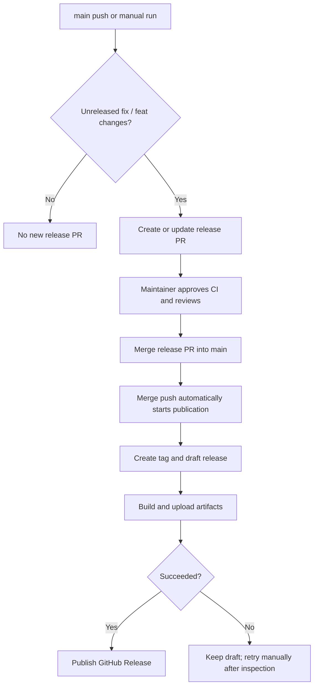

# Release process

Release Please manages the product version and changelog in a release PR. A maintainer reviews the PR and merges it manually. The workflows authenticate with GITHUB_TOKEN.

## Publication

The action runs on main pushes or manual dispatch; there is no scheduled run. It creates a release PR when main contains unreleased fix or feat changes, updates an existing PR, and creates no new PR when there are no releasable changes.

A dependency merge made with GITHUB_TOKEN does not trigger a push workflow. After that merge, select main in the Release Please workflow and run it manually with tag empty. A nonempty tag is reserved for retrying distribution and skips PR creation.

The following flow separates PR creation from publication.

Approve the PR's CI run if GitHub requests approval, review its version and compatibility, and merge it manually. That merge pushes to main and automatically starts Release Please, which creates the tag and draft release and passes the merge SHA to distribute.yml. The distribution job rejects a checkout that differs from the tag or a release that is already public.

GoReleaser builds Linux and macOS archives for amd64 and arm64, uploads checksums, and publishes versioned multi-platform containers. It preserves the draft and Release Please notes. After distribution, the workflow advances stable latest tags and publishes the GitHub Release. Prereleases do not advance latest.

## Failure and retry

Inspect the tag, commit, draft, and registry before rerunning a failed job. If the original run is unavailable, run Release Please manually on main with tag set to the existing draft tag. A retry can replace a versioned container. Public releases are rejected before the build.

Disable the Release Please workflow to stop publication, inspect any running job, and keep the release PR unmerged. Recovery is manual; no release-state service or image ownership inspection is used.

See [dependency and release operations](../dependency-release.md) for repository settings. The configuration files are [Release Please](../../release-please-config.json), the [manifest](../../.release-please-manifest.json), [GoReleaser](../../.goreleaser.yaml), and the [distribution workflow](../../.github/workflows/distribute.yml).
